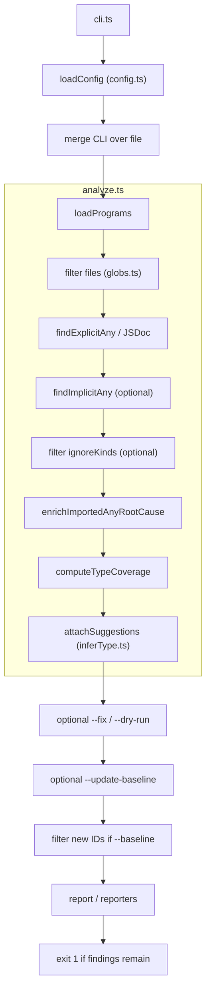
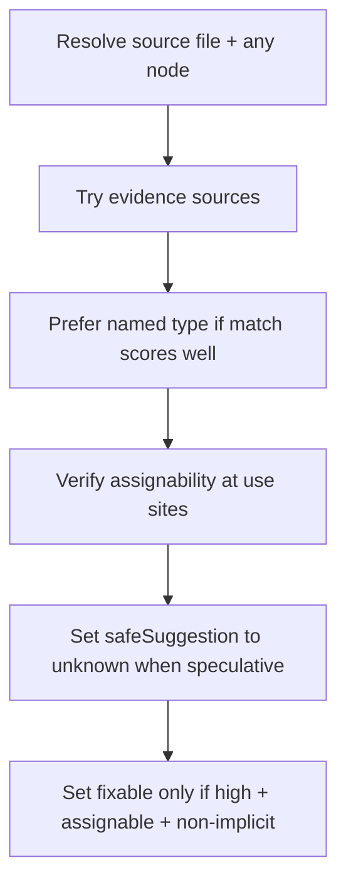
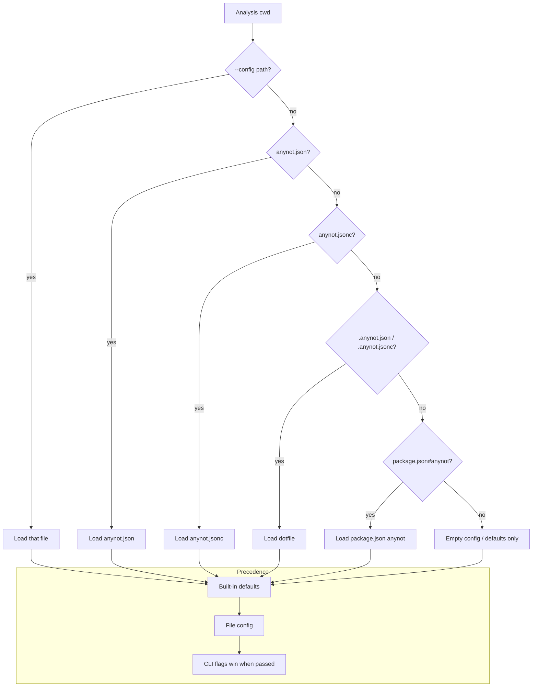

# Architecture

## Pipeline



Library users call `analyze()` (and optionally `applyFixes`) directly via `src/index.ts` exports; CLI is a thin orchestration layer around the same modules. Conceptual stages: **detect → infer → verify → report → fix/CI**.

## Key modules

| Module                | Role                                                                                                          |
| --------------------- | ------------------------------------------------------------------------------------------------------------- |
| `cli.ts`              | `cac` CLI: flags, config merge, fix/baseline orchestration, reporter dispatch, `--out` file write, exit codes |
| `config.ts`           | Discover/parse `anynot.json`(c) / `package.json#anynot`; normalize ignore+exclude; validate; unknown-key warn |
| `progress.ts`         | stderr phase status / TTY spinner; keeps machine stdout clean                                                 |
| `analyze.ts`          | Program loop, include/exclude, `ignoreKinds` filter, dedupe/sort findings, wire detect → infer → coverage     |
| `loadProgram.ts`      | Resolve tsconfig, follow project references, create `ts.Program` + checker                                    |
| `globs.ts`            | Minimal `*` / `**` / `?` include-exclude matching (no minimatch)                                              |
| `findAny.ts`          | Walk AST for `AnyKeyword`; JSDoc type tags; classify `AnyKind`; implicit diagnostics; imported-any root cause |
| `ignore.ts`           | `anynot-ignore`, `anynot-ignore-next-line`, ignore-by-id                                                      |
| `inferType.ts`        | Suggestion engine: evidence sources, named-type matching, assignability, dual best/safe, `fixable`            |
| `fix.ts`              | Apply/preview high-confidence rewrites; container-aware range (`Promise<any>` → `Promise<User>`)              |
| `report.ts`           | Human (grouped) + JSON reports; summary buckets; exit code helper                                             |
| `coverage.ts`         | Identifier walk → % not typed as `any`                                                                        |
| `baseline.ts`         | Load/update JSON of finding IDs; filter to novel IDs                                                          |
| `reporters/sarif.ts`  | SARIF 2.1.0                                                                                                   |
| `reporters/github.ts` | GitHub Actions annotations                                                                                    |
| `types.ts`            | Shared `Finding`, `Suggestion`, `AnyKind`, coverage/fix result types                                          |

## Data flow: `Finding`

Core shape (see `types.ts`):

```text
Finding
  id            sha1(file:line:column:kind).slice(0, 12)
  file/line/column, kind, snippet, symbolName?
  nodeStart/nodeEnd
  suggestion? / safeSuggestion?   // best vs conservative
  fixable? / implicit? / rootCause?
```

`Suggestion`: `typeText`, `confidence` (`high`|`medium`|`low`), `why`, `evidence?`, `assignable?`.

IDs are stable for baseline/ignore-by-id as long as file path (relative to program root), line, column, and kind stay the same.

## Detect

1. **Explicit**: visit every node; on `SyntaxKind.AnyKeyword`, classify parent context → `annotation` | `parameter` | `return` | `assertion` | `generic` | `rest`.
2. **JSDoc**: `forEachChild` does not walk JSDoc; `findAny` inspects JSDoc tags with type expressions separately → kind `jsdoc`.
3. **Ignore**: skip if same-line / previous-line directive matches, or finding id is listed in an ignore comment.
4. **Implicit** (`--include-implicit`): selected diagnostic codes (7005/7006/7008/7019/7031/7034/7043/7053, etc.) → kind `implicit`, default low-confidence `unknown` suggestion (may be upgraded via Language Service).
5. **Root cause**: for exported type aliases that re-expose package imports typed as any / untyped deps, set `rootCause`.

## Infer

`attachSuggestions` builds a named-type index from project interfaces/aliases, then per finding:



1. Resolve source file + `any` node
2. Try evidence sources in priority order (container inner type, initializer, class field assigns, destructuring, return exprs, JSX context, contextual/call-site, array callbacks, usage shape, LS inferFromUsage)
3. Prefer a named type when structural/assignable match scores well
4. **Verify**: assignability at collected use sites; downgrade confidence / mark `assignable: false` on failure
5. Set **safeSuggestion** to `unknown` when best is speculative (not high confidence or not assignable)
6. Set **fixable** only for high + assignable + non-implicit + non-forbidden (`any` banned in suggestion text)

`skipInference: true` on `AnalyzeOptions` is used by tests that only care about detection.

## Fix

`previewFixes` / `applyFixes`:

- Filter with `isFixable`
- Group by file; replace from end of file toward start
- Prefer rewriting the whole type reference when suggestion is a container form (`Promise<User>` for `Promise<any>`)
- Otherwise replace the `any` token only
- CLI `--fix` writes files, then **re-runs** `analyze` so the report reflects remaining debt
- `--dry-run` prints unified-ish hunks to stderr and does not write

## Report & CI

| Path     | Module                | Notes                                                 |
| -------- | --------------------- | ----------------------------------------------------- |
| Human    | `report.ts`           | Group by file; sort fixable/high first; coverage line |
| JSON     | `report.ts`           | Full finding + summary payload                        |
| SARIF    | `reporters/sarif.ts`  | Rule `explicit-any`                                   |
| GitHub   | `reporters/github.ts` | high confidence → `::warning`, else `::error`         |
| File out | `cli.ts` (`--out`)    | Same report body written to path; stdout left empty   |
| Progress | `progress.ts`         | Phase messages / spinner on **stderr** only           |
| Baseline | `baseline.ts` + CLI   | Report/exit use **filtered** findings only            |
| Exit     | `exitCodeForFindings` | `0` if empty, else `1`                                |

`--reporter` overrides `--json`. `--out <path>` redirects whichever report format was selected to a file (creates parent dirs) and prints `anynot: wrote report to …` on stderr. Coverage is included for human/JSON paths, not SARIF/GitHub bodies.

## Project config

Optional file under analysis cwd. Discovery order (first match wins). No file → CLI/defaults only. Invalid/missing explicit or auto-discovered config → exit `2`.



Array flags (`--include`, `--exclude`) **replace** file arrays when passed; scalars/booleans win when the flag is present. `ignore` + `exclude` in the same file concatenate uniquely into `AnalyzeOptions.exclude`. `ignoreKinds` filters findings after detect/implicit (coverage still uses included files). `--fix` / `--dry-run` / `--update-baseline` are CLI-only. JSON Schema: root `schema.json` (published in package `files`).

## Type coverage

Independent metric: count analyzable identifiers in included source files; treat checker type `any` (including unions containing `any`) as untyped. Reported as `typed/total` and percentage. Not a substitute for finding-based CI.

## Program loading notes

- Default tsconfig: `ts.findConfigFile` from cwd
- Project references are loaded recursively; findings are deduped by `id`
- Declaration files and `node_modules` are excluded from analysis walks
- Only program root file names (non-`.d.ts`) are analyzable

## Tests

Vitest under `test/`, fixtures under `test/fixtures/*`. Behavioral style: call `analyze` / `runAnynot` against fixture projects; mock only I/O boundaries when needed (temp dirs, stdout capture). See `AGENT.md`.
