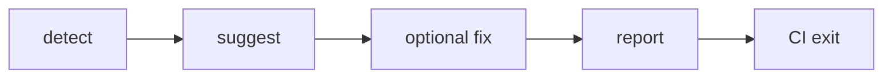

# Product

## What

**anynot** is a TypeScript CLI (and small library) that:

1. Detects explicit `any` (including JSDoc `{any}`) in a project’s TypeScript program
2. Suggests safer replacement types with confidence, evidence, and a dual best/safe pair
3. Optionally auto-fixes only high-confidence, assignable cases
4. Fits CI via exit codes, baselines, SARIF, and GitHub annotations

It is intentionally Knip-like in UX: point at a repo, get actionable findings, optionally fix what is safe.

## Why

`any` disables type checking at the boundary. Teams usually want to:

- Inventory remaining `any` debt
- Prefer concrete types when the checker can prove them
- Avoid mass-rewrites that introduce `any`-shaped “fixes” or break call sites
- Ratchedown debt in CI without blocking on the entire backlog on day one

anynot optimizes for **provable** suggestions over clever guesses. When evidence is weak, it falls back to `unknown` as the safe suggestion and leaves auto-fix off.

## Who

| Audience                  | Use                                                 |
| ------------------------- | --------------------------------------------------- |
| App / library maintainers | Local cleanup and `--fix` for easy wins             |
| Platform / DX teams       | CI gate + baseline ratchet + SARIF/GitHub reporters |
| Contributors / AI agents  | Library `analyze()` API and structured JSON output  |

## Value proposition

- **Find more than ESLint’s bare `no-explicit-any`**: kinds include annotations, params, returns, assertions, generics, rest, JSDoc; optional implicit any
- **Suggest with receipts**: confidence + evidence + assignability check at use sites
- **Safe automation**: `--fix` refuses medium/low, non-assignable, implicit, and `any`-containing suggestions
- **CI-friendly**: exit `1` on remaining findings; baseline filters known IDs; reporters for GitHub

## Scope (shipped)

- Explicit `AnyKeyword` detection via TypeScript AST
- JSDoc `@type` / `@param` / `@returns` (and similar tags with type expressions) containing `any`
- Optional `--include-implicit` from selected `noImplicitAny`-family diagnostics
- Inference from initializer, contextual types, call sites, usage (property/methods), containers (`Promise`/`Array`/…), JSX context, and Language Service `inferFromUsage` as fallback
- Named-type preference when a structural shape matches project interfaces/aliases
- Dual suggestions: best + safe (`unknown` when speculative)
- `--fix` / `--fix --dry-run`
- Grouped human report + type coverage percentage
- `--out <path>` to write human/JSON/SARIF/GitHub reports to a file (stderr keeps progress)
- Baseline load/update + filter-to-new-IDs
- `--reporter sarif` and `--reporter github`
- Progress/status on stderr so analysis does not look hung
- Ignore: same-line, next-line, and by finding id
- Include/exclude globs; tsconfig path; project references via `loadPrograms`
- Optional project config (`anynot.json` / JSONC / `package.json#anynot`) for include/ignore/tsconfig/baseline/reporter defaults; CLI overrides; `ignoreKinds` filter
- Root-cause hint when exported `any` aliases mirror untyped/any-typed package imports

## Non-goals (current)

- Not a full replacement for `tsc` or `eslint`
- Does not invent domain types or generate new interface declarations
- Does not auto-fix implicit any (suggestions may exist; `fixable` stays false)
- Does not rewrite non-`any` type debt (`unknown`, `object`, loose `Record`, etc.) except as suggestion text when replacing `any`
- Does not require or ship a cloud service
- Does not guarantee 100% correct renames when evidence is thin — that is why confidence and safe suggestions exist

## CLI surface

```text
anynot [cwd]
  --fix                  Apply high-confidence assignable replacements
  --dry-run              Preview fixes (with --fix)
  --json                 JSON report
  --out <path>           Write report to a file instead of stdout
  --reporter sarif|github
  --baseline <path>      Only novel IDs fail CI
  --update-baseline      Write IDs to baseline path
  --tsconfig <path>
  --include / --exclude  Globs (comma-separated or repeatable)
  --include-implicit     Include implicit any diagnostics
  --config <path>        Explicit anynot.json / JSONC
```

Optional project config sets include / ignore (≡ exclude globs) / tsconfig / baseline / reporter / out / json / ignoreKinds. `--fix`, `--dry-run`, and `--update-baseline` remain CLI-only.

Primary UX loop:



## Roadmap posture

Near-term posture is **deepen correctness of what exists**, not broaden into a general type refactorer:

- Better inference / assignability edge cases
- Clearer reports and CI integrations
- More stable finding IDs and baseline workflows

Future ideas (not shipped — do not document as features): editor extensions, autofix for implicit any, multi-rule lint framework. Mark any of these as speculative if mentioned in PRs or issues.
