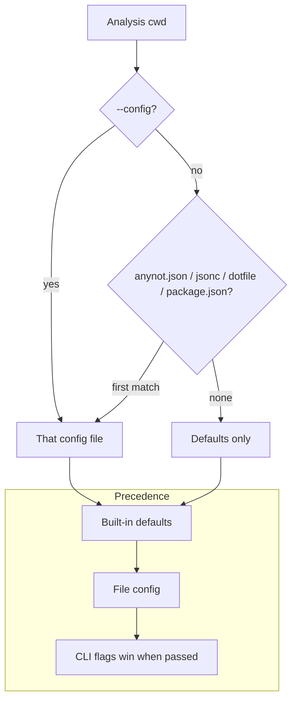

<div align="center">


# anynot

CLI that finds TypeScript `any` usages and suggests provable replacement types (with confidence and evidence). Optional `--fix` applies only high-confidence, assignable replacements.

Requires Node.js 18+ and TypeScript 5+ (peer dependency; also bundled so `npx anynot` works without a local TypeScript install).

</div>

## Install

```bash
npm install -D anynot typescript
```

## Usage

```bash
npx anynot
npx anynot path/to/project
npx anynot --json
npx anynot --json --out anynot-report.json
npx anynot --fix
npx anynot --fix --dry-run
npx anynot --tsconfig tsconfig.build.json
npx anynot --include "src/**/*.ts" --exclude "**/*.test.ts"
npx anynot --include-implicit
npx anynot --baseline .anynot-baseline.json
npx anynot --baseline .anynot-baseline.json --update-baseline
npx anynot --reporter sarif
npx anynot --reporter sarif --out anynot.sarif
npx anynot --reporter github
npx anynot --config ./config/anynot.ci.json
```

Optional `[cwd]` positional argument: analyze a directory other than the process working directory. `--fix` and `--update-baseline` only write files under that analysis cwd (paths that escape it are skipped).

Progress and status messages go to **stderr** (spinner in a TTY; plain `anynot: …` lines in CI). Report bodies go to **stdout**, or to a file when `--out` is set.

## Project config (optional)

Check in an `anynot.json` (or `anynot.jsonc` / `.anynot.json` / `package.json#anynot`) so CI and local runs share the same include/ignore defaults. CLI flags always win when passed. `--fix`, `--dry-run`, and `--update-baseline` stay CLI-only.

Discovery under the analysis cwd (first match wins), then merge:



```json
{
  "$schema": "https://unpkg.com/anynot@0.1.0/schema.json",
  "include": ["src/**/*.ts"],
  "ignore": [
    "src/**/migrations/**",
    "scripts/**"
  ],
  "tsconfig": "tsconfig.json",
  "includeImplicit": false,
  "baseline": ".anynot-baseline.json",
  "ignoreKinds": ["jsdoc"],
  "reporter": "sarif",
  "out": "anynot.sarif"
}
```

`ignore` is the Knip-familiar name for exclude globs (not Knip `ignoreDependencies`). `exclude` is an accepted alias; both are concatenated uniquely into one exclude list. Arrays from the CLI **replace** config when the flag is passed. Invalid or missing `--config` / invalid auto-discovered config → exit `2`.

## Exit codes

| Code | Meaning                                             |
| ---- | --------------------------------------------------- |
| `0`  | No findings (after baseline filtering, if used)     |
| `1`  | Findings remain (after baseline filtering, if used) |
| `2`  | CLI / config / baseline errors                      |

With `--baseline`, only finding IDs **not** listed in the baseline file cause exit `1`. Already-baselined IDs are ignored for the exit code.

## What it finds

| Kind                 | Examples                                                          |
| -------------------- | ----------------------------------------------------------------- |
| `annotation`         | `const x: any`, properties, type aliases                          |
| `parameter` / `rest` | `(payload: any)`, `(...args: any[])`                              |
| `return`             | `function f(): any`                                               |
| `assertion`          | `value as any`                                                    |
| `generic`            | `Promise<any>`, `any[]`, `Record<string, any>`                    |
| `jsdoc`              | `@type {any}`, `@param {any}`, `@returns {any}`                   |
| `implicit`           | only with `--include-implicit` (from `noImplicitAny` diagnostics) |

## Suggestions

Each finding may include:

- **best** suggestion (`suggestion`): concrete type when evidence exists
- **safe** suggestion (`safeSuggestion`): usually `unknown` when best is speculative
- **confidence**: `high` | `medium` | `low`
- **evidence**: short reasons (initializer, call-site, usage, Language Service, etc.)
- **assignable**: whether the candidate passed use-site checks
- **fixable**: whether `--fix` would rewrite it

`--fix` only rewrites findings that are high-confidence, assignable, non-implicit, and whose suggested text is not `any`. Writes are confined to the analysis cwd.

## Ignore directives

```ts
const x: any = 1; // anynot-ignore

// anynot-ignore-next-line
const y: any = 2;

// Ignore a specific finding id (12-char hex from the report)
const z: any = 3; // anynot-ignore a1b2c3d4e5f6
```

- `// anynot-ignore` on the same line suppresses that finding.
- `// anynot-ignore-next-line` suppresses the next line.
- `// anynot-ignore <id>` anywhere in the file suppresses the finding with that id (12-char hex from the report).

## Flags

| Flag                 | Purpose                                                                  |
| -------------------- | ------------------------------------------------------------------------ |
| `[cwd]`              | Optional directory to analyze (default: process cwd)                     |
| `--fix`              | Apply high-confidence assignable replacements under cwd, then re-analyze |
| `--dry-run`          | With `--fix`, preview replacements without writing files                 |
| `--json`             | JSON report (ignored when `--reporter` is set)                           |
| `--out <path>`       | Write the report to a file instead of stdout; creates parent dirs        |
| `--reporter <name>`  | `sarif` (code scanning) or `github` (workflow annotations)               |
| `--baseline <path>`  | Only finding IDs not in the baseline fail CI (exit `1`)                  |
| `--update-baseline`  | Write current finding IDs to `--baseline` path (under cwd)               |
| `--tsconfig <path>`  | Path to `tsconfig.json`                                                  |
| `--include <glob>`   | Include glob (comma-separated or repeatable)                             |
| `--exclude <glob>`   | Exclude glob (comma-separated or repeatable)                             |
| `--include-implicit` | Also report implicit any from TypeScript diagnostics                     |
| `--config <path>`    | Explicit path to `anynot.json` / `.jsonc` (overrides discovery)          |

## Reports

**Human** (default): findings grouped by file, caret under `any`, suggestion + safe fallback, summary with fixable / need review / unknown counts, and type coverage percent. Empty result: `No findings.`

**JSON** (`--json`): `{ findings, summary }` including `id`, `kind`, `suggestion`, `safeSuggestion`, `fixable`, `rootCause`, and coverage in `summary`.

**SARIF** (`--reporter sarif`): SARIF 2.1.0 for GitHub code scanning.

**GitHub** (`--reporter github`): `::error` / `::warning` workflow annotations.

### Writing to a file

```bash
npx anynot --json --out anynot-report.json
npx anynot --reporter sarif --out anynot.sarif
npx anynot --out report.txt   # human report to file
```

`--out` writes whatever format you selected (human / JSON / SARIF / GitHub) to the given path instead of stdout. Parent directories are created if needed. stderr still shows progress and a confirmation like `anynot: wrote report to anynot-report.json`.

## Baseline (CI ratchet)

```bash
# Capture current debt
npx anynot --baseline .anynot-baseline.json --update-baseline

# Fail only on new finding IDs
npx anynot --baseline .anynot-baseline.json
```

Baseline file shape: `{ "version": 1, "ids": ["…"] }` (a plain string array is also accepted when loading). Invalid or unreadable baseline files cause exit `2`.

## Library API

```ts
import { analyze, applyFixes, runAnynot } from 'anynot';

const result = analyze({ cwd: process.cwd(), includeImplicit: false });
console.log(result.findings, result.coverage);
```

Public exports live in `src/index.ts` (built to `dist/`).

## Develop

```bash
npm test
npm run typecheck
npm run lint
npm run build
```

See [PRODUCT.md](./PRODUCT.md), [ARCHITECTURE.md](./ARCHITECTURE.md), and [AGENT.md](./AGENT.md).
